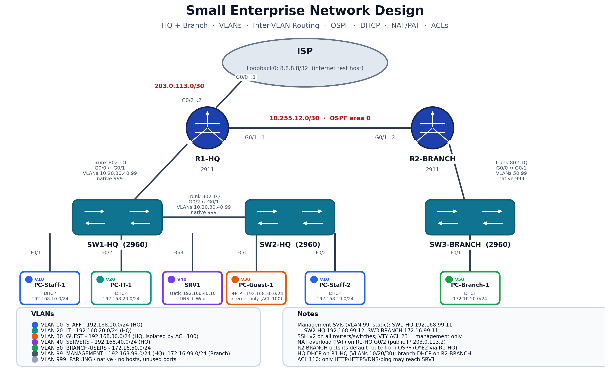
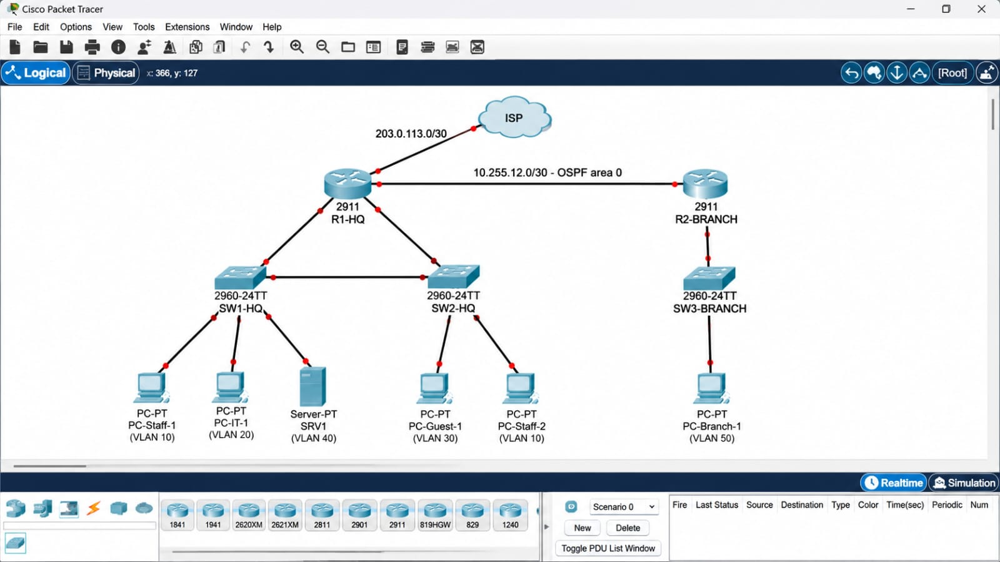

# Small Enterprise Network Design (CCNA Level)

A complete, realistic small-enterprise network built and documented for Cisco Packet Tracer:
a headquarters site and a branch office with VLAN segmentation, inter-VLAN routing,
OSPF, DHCP, NAT/PAT and security ACLs. Every device's full configuration is included
below and as a ready-to-paste file in [`configs/`](configs/).





*Small enterprise network topology.*

*Topology diagram of the final design. Interface, VLAN and subnet labels match the
configurations in this repository exactly.*

## What this project demonstrates

| Topic | Where it lives |
|---|---|
| VLANs + 802.1Q trunks | 6 VLANs across 3 switches, native VLAN 999, unused ports parked |
| Inter-VLAN routing | Router-on-a-stick on R1-HQ (HQ) and R2-BRANCH (branch) |
| OSPF | Single area 0 between R1-HQ and R2-BRANCH, passive interfaces, default-route origination |
| DHCP | Per-VLAN pools on R1-HQ (HQ) and R2-BRANCH (branch), with excluded addresses |
| NAT/PAT | Overload NAT on the HQ internet uplink, shared by HQ and branch traffic |
| ACLs | Guest-VLAN isolation (100), server protection (110), VTY restriction (23) |
| Device hardening | SSH v2, encrypted passwords, banners, port-security, PortFast + BPDU Guard |

## Device inventory

| Device | Model | Role |
|---|---|---|
| ISP | Cisco 2911 | Simulated provider router + internet test host (Loopback0 = 8.8.8.8) |
| R1-HQ | Cisco 2911 | HQ edge router: inter-VLAN routing, NAT/PAT, DHCP, OSPF, ACLs |
| R2-BRANCH | Cisco 2911 | Branch router: inter-VLAN routing, DHCP, OSPF |
| SW1-HQ | Cisco 2960 | HQ access switch 1 (staff, IT, server) |
| SW2-HQ | Cisco 2960 | HQ access switch 2 (guest, staff) |
| SW3-BRANCH | Cisco 2960 | Branch access switch |
| PCs x4 + SRV1 | End devices | DHCP clients + DNS/Web server (static) |

## IP addressing plan

### WAN links

| Link | Network | Side A | Side B |
|---|---|---|---|
| R1-HQ <-> ISP | 203.0.113.0/30 | R1 G0/2 = .2 | ISP G0/0 = .1 |
| R1-HQ <-> R2-BRANCH | 10.255.12.0/30 | R1 G0/1 = .1 | R2 G0/1 = .2 |
| Internet test host | 8.8.8.8/32 | ISP Loopback0 | - |

### VLANs and subnets

| VLAN | Name | Subnet | Gateway | Addressing |
|---|---|---|---|---|
| 10 | STAFF | 192.168.10.0/24 | 192.168.10.1 (R1) | DHCP |
| 20 | IT | 192.168.20.0/24 | 192.168.20.1 (R1) | DHCP |
| 30 | GUEST | 192.168.30.0/24 | 192.168.30.1 (R1) | DHCP, internet only (ACL 100) |
| 40 | SERVERS | 192.168.40.0/24 | 192.168.40.1 (R1) | SRV1 static = 192.168.40.10 |
| 99 | MANAGEMENT | 192.168.99.0/24 (HQ) | 192.168.99.1 (R1) | SW1 = .11, SW2 = .12 (static) |
| 50 | BRANCH-USERS | 172.16.50.0/24 | 172.16.50.1 (R2) | DHCP |
| 99 | MANAGEMENT | 172.16.99.0/24 (branch) | 172.16.99.1 (R2) | SW3 = .11 (static) |
| 999 | PARKING / native | - | - | No hosts; unused ports + trunk native VLAN |

DHCP details: R1-HQ serves VLANs 10/20/30 (excludes .1-.10, DNS = 192.168.40.10 for staff/IT
and 8.8.8.8 for guests, since ACL 100 keeps guests off the internal server). R2-BRANCH serves
VLAN 50 (excludes .1-.10, DNS = 192.168.40.10).

## Repository layout

```
configs/     one ready-to-paste file per device (the same configs shown below)
topology/    topology diagram (PNG) + the Python script that draws it
README.md    this file
```

## Rebuild it in Cisco Packet Tracer

Everything below uses only devices and features available in standard Packet Tracer.

1. **Place the devices.** 3x 2911 routers (name them ISP, R1-HQ, R2-BRANCH), 3x 2960
   switches (SW1-HQ, SW2-HQ, SW3-BRANCH), 4 PCs, 1 server (SRV1).
2. **Cable it** exactly as the topology diagram shows:
   - R1-HQ G0/2 -> ISP G0/0 (copper straight-through works in PT between router G0/2
     and router G0/0; use automatic if unsure)
   - R1-HQ G0/1 -> R2-BRANCH G0/1
   - R1-HQ G0/0 -> SW1-HQ G0/1
   - SW1-HQ G0/2 -> SW2-HQ G0/1
   - R2-BRANCH G0/0 -> SW3-BRANCH G0/1
   - PC-Staff-1 -> SW1 F0/1, PC-IT-1 -> SW1 F0/2, SRV1 -> SW1 F0/3
   - PC-Guest-1 -> SW2 F0/1, PC-Staff-2 -> SW2 F0/2
   - PC-Branch-1 -> SW3 F0/1
3. **Configure the switches first** (paste `SW1-HQ.cfg`, `SW2-HQ.cfg`, `SW3-BRANCH.cfg`).
   Paste into CLI from privileged EXEC: `enable`, `configure terminal`, then the file
   contents. If a 2960 image rejects `crypto key generate rsa`, skip the SSH block on
   that switch (a known PT limitation on some images) - everything else still works.
4. **Configure the routers** (`R1-HQ.cfg`, `R2-BRANCH.cfg`, then `ISP.cfg`).
   When `crypto key generate rsa` asks for a modulus, enter **2048**.
5. **Set the static host.** On SRV1 (Desktop > IP Configuration): IP 192.168.40.10,
   mask 255.255.255.0, gateway 192.168.40.1, DNS 8.8.8.8. Then open SRV1's Services tab,
   turn on **HTTP**, and under **DNS** add one A record, e.g. `server.lab` ->
   192.168.40.10, and set DNS to On, so you can test name resolution.
6. **Set every PC to DHCP** (Desktop tab -> IP Configuration -> DHCP). Each PC should
   receive an address in its VLAN's subnet.
7. **Verify** with the checklist below, then capture your own screenshots (see the last
   section).

## Verification checklist

| Test | Command / action | Expected result |
|---|---|---|
| DHCP | `ipconfig` on each PC (Desktop > Command Prompt) | Address from the right pool, correct gateway + DNS |
| Inter-VLAN routing | PC-Staff-1 `ping 192.168.20.x` (PC-IT-1) | Replies via R1-HQ |
| OSPF adjacency | `show ip ospf neighbor` on R1-HQ | R2-BRANCH (2.2.2.2) in FULL state |
| OSPF routes | `show ip route` on R2-BRANCH | All HQ VLANs learned as `O`, plus `O*E2 0.0.0.0/0` |
| WAN path | PC-Branch-1 `ping 192.168.10.x` (PC-Staff-1) | Replies over the 10.255.12.0/30 link |
| NAT/PAT | PC-IT-1 `ping 8.8.8.8`, then `show ip nat translations` on R1-HQ | Translation to 203.0.113.2 |
| Guest isolation | PC-Guest-1 `ping 8.8.8.8` = works; `ping 192.168.10.1` | Internet works, internal ping fails (ACL 100) |
| Server ACL | PC-Staff-1 opens `http://192.168.40.10` in the web browser | Page loads (ACL 110 allows web/DNS/icmp) |
| Management SSH | From a VLAN-99 host: `ssh -l admin 192.168.99.1` | Login prompt; same attempt from VLAN 10 fails (ACL 23) |
| Port security | Move a PC to a different access port | `show port-security` on the switch shows the sticky MAC |

## Full device configurations

These are identical to the files in `configs/` - paste either one.

<details>
<summary><strong>ISP.cfg</strong></summary>

```text
! ============================================================
! ISP - Simulated service-provider router (Cisco 2911)
! Role: internet edge simulation. Provides the HQ uplink and a
! loopback (8.8.8.8) used as the "internet host" for testing.
! In a real deployment this device belongs to the ISP and you
! would not configure it.
! ============================================================
enable
configure terminal
!
hostname ISP
!
no ip domain-lookup
enable secret ISP-Lab-123
service password-encryption
banner motd #Authorized access only - ISP simulation#
!
interface Loopback0
 description Simulated Internet host (test target)
 ip address 8.8.8.8 255.255.255.255
!
interface GigabitEthernet0/0
 description Uplink to R1-HQ G0/2 (203.0.113.0/30)
 ip address 203.0.113.1 255.255.255.252
 no shutdown
!
! No routing protocol needed: the customer's NAT pool address
! (203.0.113.2) sits on the directly connected /30, so return
! traffic to HQ hosts is already reachable.
!
end
copy running-config startup-config
```

</details>

<details>
<summary><strong>R1-HQ.cfg</strong></summary>

```text
! ============================================================
! R1-HQ - HQ edge + inter-VLAN router (Cisco 2911)
! - Router-on-a-stick for HQ VLANs 10/20/30/40/99 (G0/0)
! - Point-to-point WAN link to the branch (G0/1, OSPF area 0)
! - Internet uplink with NAT overload / PAT (G0/2)
! - DHCP server for HQ user VLANs
! - Security ACLs: guest isolation, server protection, VTY ACL
! ============================================================
enable
configure terminal
!
hostname R1-HQ
!
no ip domain-lookup
enable secret HQ-Lab-123
service password-encryption
banner motd #Authorized access only - R1-HQ#
!
! ---- Local admin account + SSH ----------------------------
username admin secret CCNA-Lab-123
ip domain-name yousef.lab
crypto key generate rsa
!   (enter 2048 when prompted for the modulus size)
ip ssh version 2
!
! ---- Routed WAN link to the branch -------------------------
interface GigabitEthernet0/1
 description P2P to R2-BRANCH G0/1 (10.255.12.0/30)
 ip address 10.255.12.1 255.255.255.252
 ip nat inside
 no shutdown
!
! ---- Internet uplink ---------------------------------------
interface GigabitEthernet0/2
 description Uplink to ISP G0/0 (203.0.113.0/30)
 ip address 203.0.113.2 255.255.255.252
 ip nat outside
 no shutdown
!
! ---- Router-on-a-stick trunk to SW1-HQ (G0/0) --------------
interface GigabitEthernet0/0
 description Trunk to SW1-HQ G0/1 (VLANs 10,20,30,40,99)
 no shutdown
!
interface GigabitEthernet0/0.10
 description VLAN 10 - Staff
 encapsulation dot1Q 10
 ip address 192.168.10.1 255.255.255.0
 ip nat inside
!
interface GigabitEthernet0/0.20
 description VLAN 20 - IT
 encapsulation dot1Q 20
 ip address 192.168.20.1 255.255.255.0
 ip nat inside
!
interface GigabitEthernet0/0.30
 description VLAN 30 - Guest
 encapsulation dot1Q 30
 ip address 192.168.30.1 255.255.255.0
 ip nat inside
 ip access-group 100 in
!
interface GigabitEthernet0/0.40
 description VLAN 40 - Servers
 encapsulation dot1Q 40
 ip address 192.168.40.1 255.255.255.0
 ip nat inside
 ip access-group 110 out
!
interface GigabitEthernet0/0.99
 description VLAN 99 - Management
 encapsulation dot1Q 99
 ip address 192.168.99.1 255.255.255.0
 ip nat inside
!
! ---- Default route to the ISP ------------------------------
ip route 0.0.0.0 0.0.0.0 203.0.113.1
!
! ---- OSPF (area 0) to the branch ---------------------------
router ospf 1
 router-id 1.1.1.1
 passive-interface default
 no passive-interface GigabitEthernet0/1
 network 192.168.10.0 0.0.0.255 area 0
 network 192.168.20.0 0.0.0.255 area 0
 network 192.168.30.0 0.0.0.255 area 0
 network 192.168.40.0 0.0.0.255 area 0
 network 192.168.99.0 0.0.0.255 area 0
 network 10.255.12.0 0.0.0.3 area 0
 default-information originate
!
! ---- NAT overload (PAT) ------------------------------------
access-list 1 remark Inside networks allowed to use NAT
access-list 1 permit 192.168.0.0 0.0.255.255
access-list 1 permit 172.16.0.0 0.15.255.255
ip nat inside source list 1 interface GigabitEthernet0/2 overload
!
! ---- DHCP for HQ user VLANs --------------------------------
! (Servers VLAN 40 and Management VLAN 99 use static IPs.)
ip dhcp excluded-address 192.168.10.1 192.168.10.10
ip dhcp excluded-address 192.168.20.1 192.168.20.10
ip dhcp excluded-address 192.168.30.1 192.168.30.10
!
ip dhcp pool HQ-STAFF
 network 192.168.10.0 255.255.255.0
 default-router 192.168.10.1
 dns-server 192.168.40.10
!
ip dhcp pool HQ-IT
 network 192.168.20.0 255.255.255.0
 default-router 192.168.20.1
 dns-server 192.168.40.10
!
ip dhcp pool HQ-GUEST
 network 192.168.30.0 255.255.255.0
 default-router 192.168.30.1
 dns-server 8.8.8.8
! (guests cannot reach the internal DNS server - ACL 100 blocks it,
!  so they get a public resolver instead)
!
! ---- Security ACLs ------------------------------------------
! ACL 100: guests get DHCP and internet, but nothing internal.
access-list 100 remark Guest VLAN isolation
access-list 100 permit udp any eq bootpc any eq bootps
access-list 100 deny ip 192.168.30.0 0.0.0.255 192.168.0.0 0.0.255.255
access-list 100 deny ip 192.168.30.0 0.0.0.255 172.16.0.0 0.15.255.255
access-list 100 permit ip any any
!
! ACL 110: only web, DNS and ping may reach the server.
access-list 110 remark Server protection
access-list 110 permit tcp any host 192.168.40.10 eq www
access-list 110 permit tcp any host 192.168.40.10 eq 443
access-list 110 permit udp any host 192.168.40.10 eq domain
access-list 110 permit tcp any host 192.168.40.10 eq domain
access-list 110 permit icmp any host 192.168.40.10
access-list 110 permit ip any 192.168.40.0 0.0.0.255
!
! ACL 23: SSH to the routers only from management VLANs.
access-list 23 remark VTY management access
access-list 23 permit 192.168.99.0 0.0.0.255
access-list 23 permit 172.16.99.0 0.0.0.255
!
line vty 0 15
 access-class 23 in
 login local
 transport input ssh
!
line console 0
 login local
 logging synchronous
!
end
copy running-config startup-config
```

</details>

<details>
<summary><strong>R2-BRANCH.cfg</strong></summary>

```text
! ============================================================
! R2-BRANCH - Branch office router (Cisco 2911)
! - Point-to-point WAN link to HQ (G0/1, OSPF area 0)
! - Router-on-a-stick for branch VLANs 50/99 (G0/0)
! - DHCP server for the branch user VLAN
! - Learns its default route from R1-HQ over OSPF
!   (internet traffic is NATed at R1-HQ)
! ============================================================
enable
configure terminal
!
hostname R2-BRANCH
!
no ip domain-lookup
enable secret BR-Lab-123
service password-encryption
banner motd #Authorized access only - R2-BRANCH#
!
username admin secret CCNA-Lab-123
ip domain-name yousef.lab
crypto key generate rsa
!   (enter 2048 when prompted for the modulus size)
ip ssh version 2
!
! ---- Routed WAN link to HQ ---------------------------------
interface GigabitEthernet0/1
 description P2P to R1-HQ G0/1 (10.255.12.0/30)
 ip address 10.255.12.2 255.255.255.252
 no shutdown
!
! ---- Router-on-a-stick trunk to SW3-BRANCH (G0/0) ----------
interface GigabitEthernet0/0
 description Trunk to SW3-BRANCH G0/1 (VLANs 50,99)
 no shutdown
!
interface GigabitEthernet0/0.50
 description VLAN 50 - Branch Users
 encapsulation dot1Q 50
 ip address 172.16.50.1 255.255.255.0
!
interface GigabitEthernet0/0.99
 description VLAN 99 - Management
 encapsulation dot1Q 99
 ip address 172.16.99.1 255.255.255.0
!
! ---- OSPF (area 0) to HQ -----------------------------------
! No static default here: R1-HQ advertises one with
! default-information originate.
router ospf 1
 router-id 2.2.2.2
 passive-interface default
 no passive-interface GigabitEthernet0/1
 network 172.16.50.0 0.0.0.255 area 0
 network 172.16.99.0 0.0.0.255 area 0
 network 10.255.12.0 0.0.0.3 area 0
!
! ---- DHCP for the branch user VLAN --------------------------
ip dhcp excluded-address 172.16.50.1 172.16.50.10
!
ip dhcp pool BRANCH-USERS
 network 172.16.50.0 255.255.255.0
 default-router 172.16.50.1
 dns-server 192.168.40.10
!
! ---- VTY protection (SSH from management VLANs only) --------
access-list 23 remark VTY management access
access-list 23 permit 192.168.99.0 0.0.0.255
access-list 23 permit 172.16.99.0 0.0.0.255
!
line vty 0 15
 access-class 23 in
 login local
 transport input ssh
!
line console 0
 login local
 logging synchronous
!
end
copy running-config startup-config
```

</details>

<details>
<summary><strong>SW1-HQ.cfg</strong></summary>

```text
! ============================================================
! SW1-HQ - HQ access switch 1 (Cisco 2960)
! - VLANs 10/20/30/40/99, parking/native VLAN 999
! - Trunks to R1-HQ (G0/1) and SW2-HQ (G0/2), native VLAN 999
! - Access ports with PortFast, BPDU Guard and port-security
! - Management SVI in VLAN 99 with SSH
! ============================================================
enable
configure terminal
!
hostname SW1-HQ
!
no ip domain-lookup
enable secret HQ-Lab-123
service password-encryption
banner motd #Authorized access only - SW1-HQ#
!
username admin secret CCNA-Lab-123
ip domain-name yousef.lab
crypto key generate rsa
!   (enter 2048 when prompted; if the 2960 image has no crypto,
!    skip the SSH commands and use Telnet from VLAN 99 only)
ip ssh version 2
!
! ---- VLANs ---------------------------------------------------
vlan 10
 name STAFF
vlan 20
 name IT
vlan 30
 name GUEST
vlan 40
 name SERVERS
vlan 99
 name MANAGEMENT
vlan 999
 name PARKING-NATIVE
!
! ---- Trunks (native VLAN 999 = unused, a security best practice)
interface GigabitEthernet0/1
 description Trunk to R1-HQ G0/0
 switchport mode trunk
 switchport trunk native vlan 999
 switchport trunk allowed vlan 10,20,30,40,99,999
!
interface GigabitEthernet0/2
 description Trunk to SW2-HQ G0/1
 switchport mode trunk
 switchport trunk native vlan 999
 switchport trunk allowed vlan 10,20,30,40,99,999
!
! ---- Access ports --------------------------------------------
interface FastEthernet0/1
 description PC-Staff-1
 switchport mode access
 switchport access vlan 10
 spanning-tree portfast
 spanning-tree bpduguard enable
 switchport port-security
 switchport port-security maximum 2
 switchport port-security mac-address sticky
 switchport port-security violation restrict
!
interface FastEthernet0/2
 description PC-IT-1
 switchport mode access
 switchport access vlan 20
 spanning-tree portfast
 spanning-tree bpduguard enable
 switchport port-security
 switchport port-security maximum 2
 switchport port-security mac-address sticky
 switchport port-security violation restrict
!
interface FastEthernet0/3
 description SRV1 (DNS + Web)
 switchport mode access
 switchport access vlan 40
 spanning-tree portfast
 spanning-tree bpduguard enable
 switchport port-security
 switchport port-security maximum 2
 switchport port-security mac-address sticky
 switchport port-security violation restrict
!
! ---- Shut down and park every unused port --------------------
interface range FastEthernet0/4 - 24
 description Unused - parked
 switchport mode access
 switchport access vlan 999
 shutdown
!
! ---- Management ----------------------------------------------
interface Vlan99
 description Management SVI
 ip address 192.168.99.11 255.255.255.0
 no shutdown
!
ip default-gateway 192.168.99.1
!
line vty 0 15
 login local
 transport input ssh
!
line console 0
 login local
 logging synchronous
!
end
copy running-config startup-config
```

</details>

<details>
<summary><strong>SW2-HQ.cfg</strong></summary>

```text
! ============================================================
! SW2-HQ - HQ access switch 2 (Cisco 2960)
! - Trunks up to SW1-HQ (G0/1), native VLAN 999
! - Access ports for the Guest and Staff VLANs
! - Same access-port hardening and management SVI as SW1-HQ
! ============================================================
enable
configure terminal
!
hostname SW2-HQ
!
no ip domain-lookup
enable secret HQ-Lab-123
service password-encryption
banner motd #Authorized access only - SW2-HQ#
!
username admin secret CCNA-Lab-123
ip domain-name yousef.lab
crypto key generate rsa
!   (enter 2048 when prompted; if the 2960 image has no crypto,
!    skip the SSH commands and use Telnet from VLAN 99 only)
ip ssh version 2
!
vlan 10
 name STAFF
vlan 20
 name IT
vlan 30
 name GUEST
vlan 40
 name SERVERS
vlan 99
 name MANAGEMENT
vlan 999
 name PARKING-NATIVE
!
interface GigabitEthernet0/1
 description Trunk to SW1-HQ G0/2
 switchport mode trunk
 switchport trunk native vlan 999
 switchport trunk allowed vlan 10,20,30,40,99,999
!
interface FastEthernet0/1
 description PC-Guest-1
 switchport mode access
 switchport access vlan 30
 spanning-tree portfast
 spanning-tree bpduguard enable
 switchport port-security
 switchport port-security maximum 2
 switchport port-security mac-address sticky
 switchport port-security violation restrict
!
interface FastEthernet0/2
 description PC-Staff-2
 switchport mode access
 switchport access vlan 10
 spanning-tree portfast
 spanning-tree bpduguard enable
 switchport port-security
 switchport port-security maximum 2
 switchport port-security mac-address sticky
 switchport port-security violation restrict
!
interface range FastEthernet0/3 - 24
 description Unused - parked
 switchport mode access
 switchport access vlan 999
 shutdown
!
interface GigabitEthernet0/2
 description Unused - parked
 switchport mode access
 switchport access vlan 999
 shutdown
!
interface Vlan99
 description Management SVI
 ip address 192.168.99.12 255.255.255.0
 no shutdown
!
ip default-gateway 192.168.99.1
!
line vty 0 15
 login local
 transport input ssh
!
line console 0
 login local
 logging synchronous
!
end
copy running-config startup-config
```

</details>

<details>
<summary><strong>SW3-BRANCH.cfg</strong></summary>

```text
! ============================================================
! SW3-BRANCH - Branch access switch (Cisco 2960)
! - VLANs 50/99, parking/native VLAN 999
! - Trunk to R2-BRANCH (G0/1), native VLAN 999
! - Access port for the branch user PC
! - Management SVI in VLAN 99 (branch subnet) with SSH
! ============================================================
enable
configure terminal
!
hostname SW3-BRANCH
!
no ip domain-lookup
enable secret BR-Lab-123
service password-encryption
banner motd #Authorized access only - SW3-BRANCH#
!
username admin secret CCNA-Lab-123
ip domain-name yousef.lab
crypto key generate rsa
!   (enter 2048 when prompted; if the 2960 image has no crypto,
!    skip the SSH commands and use Telnet from VLAN 99 only)
ip ssh version 2
!
vlan 50
 name BRANCH-USERS
vlan 99
 name MANAGEMENT
vlan 999
 name PARKING-NATIVE
!
interface GigabitEthernet0/1
 description Trunk to R2-BRANCH G0/0
 switchport mode trunk
 switchport trunk native vlan 999
 switchport trunk allowed vlan 50,99,999
!
interface FastEthernet0/1
 description PC-Branch-1
 switchport mode access
 switchport access vlan 50
 spanning-tree portfast
 spanning-tree bpduguard enable
 switchport port-security
 switchport port-security maximum 2
 switchport port-security mac-address sticky
 switchport port-security violation restrict
!
interface range FastEthernet0/2 - 24
 description Unused - parked
 switchport mode access
 switchport access vlan 999
 shutdown
!
interface GigabitEthernet0/2
 description Unused - parked
 switchport mode access
 switchport access vlan 999
 shutdown
!
interface Vlan99
 description Management SVI
 ip address 172.16.99.11 255.255.255.0
 no shutdown
!
ip default-gateway 172.16.99.1
!
line vty 0 15
 login local
 transport input ssh
!
line console 0
 login local
 logging synchronous
!
end
copy running-config startup-config
```

</details>

## Capturing your own screenshots

The images in this repo are diagrams, not Packet Tracer captures. If you need real lab
screenshots (for a CV or report), rebuild the lab above and capture:

1. The **workspace topology** after cabling (Logical view).
2. `show ip route` on R2-BRANCH (shows the OSPF routes + learned default).
3. A successful PC-to-PC ping across sites and `show ip nat translations` on R1-HQ.
4. The failed guest-to-internal ping next to a successful guest-to-8.8.8.8 ping.

## Notes

- All credentials (`CCNA-Lab-123`, `HQ-Lab-123`, `BR-Lab-123`, `ISP-Lab-123`) are
  lab-only values, not real secrets.
- Address space uses RFC 1918 + TEST-NET ranges (192.168/16, 172.16/12, 203.0.113/24),
  safe for documentation and labs.
